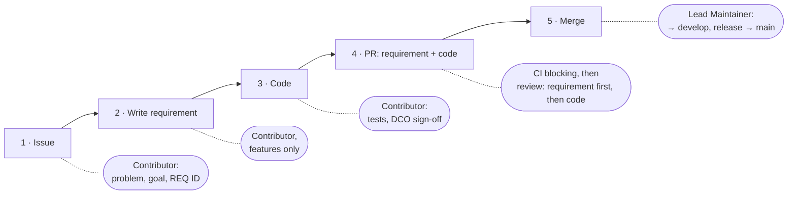
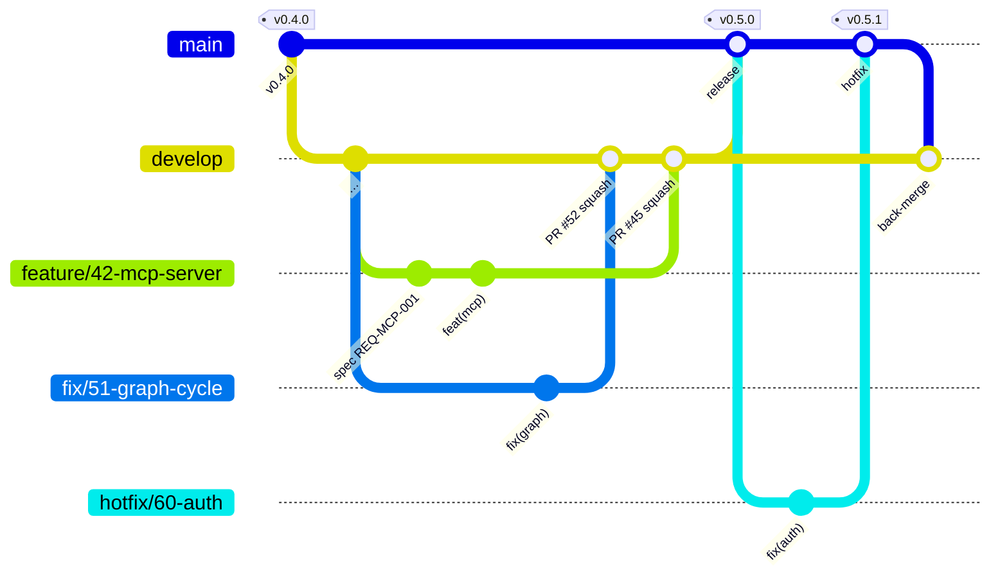

# Contributing to normly

How contributions to normly come together – from issue to release. The
process is deliberately lightweight and grows with the project.

Contributions are explicitly **not just code**. Correcting a cross-reference
between standards, reporting a wrong supersession chain, or suggesting a
source contributes to the most valuable part of the project — practical
domain knowledge is often more useful here than a patch.

## Principles

1. **Requirement before code.** Every functional change traces back to a
   requirement in [docs/srs/03-requirements.md](docs/srs/03-requirements.md).
2. **Traceable.** Every contribution carries the chain *issue → REQ ID → PR*.
3. **CI decides first.** The pipeline (tests, docs build, shellcheck) is
   blocking. Humans review requirement conformance and design.
4. **AI is welcome.** Under the rules in [Working with AI](#working-with-ai).

## Roles

| Role | Decides on |
|---|---|
| **Contributor** – anyone with a PR | Requirement draft and implementation |
| **Maintainer** – listed in [MAINTAINERS.md](MAINTAINERS.md) | Requirement approval, review |
| **Lead Maintainer** – listed in [MAINTAINERS.md](MAINTAINERS.md) | Architecture (ADRs), every merge into `develop` and `main`, releases, conflicts |

Roles are hats, not people: whoever wants to build a feature writes its
requirement. Process and licensing questions are decided by normly e.V.
If the Lead Maintainers disagree, the board of normly e.V. decides. Details
in [GOVERNANCE.md](GOVERNANCE.md).

## Workflow



Two kinds of contribution determine whether step 2 is needed:

| | **Fix** | **Feature** |
|---|---|---|
| What | Bug, docs, refactoring within an existing requirement | New or changed functionality, including new documentation |
| Requirement | Reference to an existing REQ ID is enough | New or changed REQ with acceptance criteria in the same PR; a separate requirement PR is optional for early feedback |
| Review | Maintainer | Maintainer; if data model or interfaces are affected, additionally an ADR and a Lead Maintainer |
| Merge | Lead Maintainer | Lead Maintainer |

**Requirement** = an entry in [docs/srs/03-requirements.md](docs/srs/03-requirements.md)
with a stable ID (`REQ-<DOMAIN>-<NNN>`) and acceptance criteria; the
requirement index is in [docs/srs/README.md](docs/srs/README.md).
**ADR** = Architecture Decision Record in [docs/adr/README.md](docs/adr/README.md),
recording *why* something is built the way it is.

## Branches

| Branch | Purpose |
|---|---|
| `main` | Production, tagged releases, protected |
| `develop` | Integration and default branch, protected, merge only via PR with green CI |
| `feature/<issue>-…`, `fix/<issue>-…` | Work branches off `develop`, squash-merged into `develop` |
| `hotfix/<issue>-…` | Critical fixes off `main`, merged into `main`, then `main` is merged back into `develop` |



Only Lead Maintainers merge. Work branches are **squash-merged** into
`develop` — one commit per PR. The release (`develop` → `main`), hotfixes
into `main` and the back-merge (`main` → `develop`) are **merge commits**:
squashing them would give `main` commits that `develop` does not know, and
every later back-merge would conflict. Releases are tagged on `main`; see
[docs/guide/releasing.md](docs/guide/releasing.md). The `edge` container
image is built from `main` only, so it always reflects production
(ADR-028).

## Commits

Commits follow [Conventional Commits](https://www.conventionalcommits.org/),
name the REQ ID and carry the DCO sign-off:

```
feat(graph): resolve supersession chains recursively

Implements REQ-GRAPH-006. Refs: #42

Signed-off-by: First Last <mail@example.org>
Assisted-by: Claude Code
```

`Assisted-by:` appears only if AI was used — see
[Working with AI](#working-with-ai).

## Developer Certificate of Origin (DCO)

normly uses the **DCO** instead of a Contributor License Agreement. You
don't transfer any rights; you only confirm that you're allowed to
contribute the change. The full text is at <https://developercertificate.org/>.

Every commit needs a `Signed-off-by` line for this:

```bash
git commit -s -m "fix: correct supersession chain for DIN EN ISO 9001"
```

The `-s` flag automatically appends:

```
Signed-off-by: First Last <mail@example.org>
```

Name and email must match your git configuration. Pseudonyms are not
allowed — the DCO requires an identifiable person. If you don't want your
private address in public commits, use the noreply address GitHub shows
under *Settings → Emails*.

Forgot to sign off? Sign afterwards:

```bash
git commit --amend -s          # last commit
git rebase --signoff develop   # multiple commits
```

There is no automatic check: every contributor signs off their own
commits. The merging Lead Maintainer checks the sign-offs and keeps the
`Signed-off-by` lines in the squash commit message. Without a sign-off,
nothing gets merged.

**Deliberate consequence:** because the rights stay with the contributors, a
later relicensing of the core is permanently ruled out. That's intentional —
see [ADR-003](docs/adr/README.md).

## Pull requests

Open the PR against `develop` (hotfix: against `main`). The
[PR template](.github/pull_request_template.md) asks for the issue, the
REQ ID, the type and a short checklist: tests, documentation, ADR draft,
breaking changes, new data sources, dependency licenses, license headers,
credentials, DCO, AI use.

Issues start from the forms under *New issue*: bug, feature, data error,
new data source. Security vulnerabilities are **not** reported as an issue —
see [SECURITY.md](SECURITY.md).

## Working with AI

AI-assisted development is explicitly welcome. Five rules:

1. **A human is accountable.** Whoever opens the PR understands every line
   and can explain it. The sign-off is always that of a natural person.
2. **Transparency.** AI use is stated in the PR and as `Assisted-by:` in
   the commit — never as `Co-Authored-By` and never as `Signed-off-by`.
3. **The requirement is the source.** Code that deviates from the
   requirement is wrong – regardless of who wrote it.
4. **No third-party content in prompts.** Licensed standards texts,
   partner data, secrets, personal data.
5. **AI reviews, it does not decide.** An approval comes from a human.

## Scaling

| | **Now** (core team) | **Once external contributions arrive** |
|---|---|---|
| Internal review | Lead Maintainer merges after green CI; architecture always Lead Maintainer | unchanged |
| External review | – | 1 Maintainer reviews, a Lead Maintainer merges |
| Branch protection | `develop` and `main`: PR with green CI required, merge only by Lead Maintainers | + required review for external PRs, CODEOWNERS per module |

Merging without a second review within the core team is a deliberate risk
carried by CI – which is why a working test suite is a prerequisite for
this process.

## Development setup

The four Python packages (`core`, `api`, `chat`, `accounts`) form one
[uv](https://docs.astral.sh/uv/) workspace with a single lock file
(`uv.lock`). One environment in the repository root serves all of them:

```bash
curl -LsSf https://astral.sh/uv/0.12.23/install.sh | sh
uv sync --all-packages --all-extras      # creates .venv with every package and dev extra
cd api && ../.venv/bin/pytest            # run one package's tests (needs Docker for testcontainers)
```

`uv sync` keeps `.venv` in step with `uv.lock`. Change a dependency in a
package's `pyproject.toml`, then run `uv lock` and commit the updated
`uv.lock` with it — CI installs with `--locked` and fails when the lock
file is out of date. The frontend uses `npm ci` with `package-lock.json`
as before.

## License header

New files in the core:

```
// SPDX-License-Identifier: AGPL-3.0-or-later
// Copyright (C) 2026 normly contributors
```

In SDKs and the API specification, use `Apache-2.0` instead.

## Non-negotiable boundaries

These points have legal or strategic reasons. We can't accept PRs that
violate them — even if the code is good. Better to ask in an issue first.

- **No US services** for operations, user data, the standards knowledge
  base, credentials, or production deployment. Exception since ADR-021:
  source code, CI/CD, and the container registry of the free core live on
  GitHub.
- **No scraping of commercially exploited catalog holdings.** Not even if
  they're publicly accessible. New sources need an entry in the source
  registry with an assigned legal basis.
- **No DRM or protection logic in the free core.** Exposed protection code
  is no protection; such components live outside this repository.
- **No account requirement for free content.**
- **No personalized advertising**, no user profiles for advertising
  purposes.
- **No proprietary component in the core.** It must remain buildable,
  testable, and runnable without add-on modules.
- **No direct database access** outside the repository layer.

Detailed rationale: [docs/adr/](docs/adr/).

## Contributions without code

- **Errors in the data** — a wrong reference, an outdated validity status,
  a missing supersession: use the *Data error* form, with a source.
  Especially welcome.
- **New sources** — use the *New data source* form: which standard, which
  publisher, which legal basis for use.
- **Translations and terminology** — normly is meant to work worldwide in
  the long run.
- **Documentation** — if something was unclear, it was unclear.

## Conduct

The [Code of Conduct](CODE_OF_CONDUCT.md) applies.

## Questions

For anything unclear: open an issue. Better one question too many than a
day of wasted work.

---

Changes to this document go through a PR labelled `process`.
