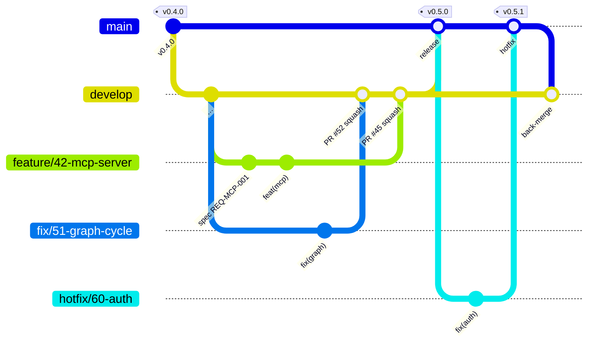

# normly

**AI-powered norms and standards, open to everyone.**

normly makes knowledge about norms and standards as freely accessible as
the law allows — and builds an open, machine-readable reference graph on top
of it: which standards reference each other, what was superseded by what,
and which legal provision references which standard.

> ⚠️ **Early development stage.** This repository is under construction.
> There is no working release yet and no stable API.

## Why

Anyone who wants to know which standard applies to a task, whether it's still
valid, and what it superseded, finds no good answer today. Standards are
scattered across different publishers, their cross-references are nowhere
captured in a machine-readable way, and many freely available texts —
accident-prevention regulations, technical rules, EU directives — are public
in principle but hard to find in practice.

normly is built for the people who work with this material every day:
skilled trades, planning, occupational safety, and small to medium
businesses.

## What's free and what isn't

normly follows an **open-core model**. The line runs through content, not
through the access path.

**Free** — the core, the reference graph, and all content that may be freely
redistributed: official works, DGUV Regeln, BAuA technical rules, EU
directives via EUR-Lex, open standards. Usable without an account, without
payment, self-hostable.

**Paid** — managed hosting with an SLA, compliance instances with an audit
trail, integrations into CAD and ERP systems, and instances with
contractually licensed full texts of standards.

Copyrighted full texts are **not** redistributed freely. Where they are
processed, that happens on a contractual basis — with revenue share for the
publishers.

What normly explicitly does **not** do: no personalized advertising, no user
profiles for advertising purposes, no scraping of commercially exploited
standards catalogs.

## Licenses

| Component | License |
|---|---|
| Core (server, application) | AGPL-3.0 |
| Client SDKs, API specification | Apache-2.0 |
| Data and reference graph | ODbL |
| `normly` trademark | see [TRADEMARK.md](TRADEMARK.md) |

The AGPL applies when someone modifies and operates the server itself. A
third-party system that talks to a normly instance over the HTTP API is a
separate program and unaffected — integrations are explicitly welcome.

## Contributing

Every contribution follows the same path: **issue → requirement → branch →
pull request → merge by a Lead Maintainer.** Branch off `develop` as
`feature/<issue>-…` or `fix/<issue>-…`, open the PR against `develop`;
critical fixes go as `hotfix/<issue>-…` against `main`. Releases are merged
from `develop` into `main` and tagged.



Contributions go through the **Developer Certificate of Origin** (DCO), not
a transfer of rights. Every commit needs a `Signed-off-by` line:

```bash
git commit -s -m "feat: short description"
```

Details — roles, requirements, merge rules, working with AI — in
[CONTRIBUTING.md](CONTRIBUTING.md). Please **do not** report security
vulnerabilities as an issue — see [SECURITY.md](SECURITY.md).

## Where the code lives

Source code, contributions, CI/CD, and the container registry for the free
core live on **GitHub**: [github.com/normly/web-app](https://github.com/normly/web-app)
(ADR-021) — easier collaboration was the reason for the move back. Operations,
user data, and the future standards knowledge base stay separate from that
and remain exclusively on STACKIT infrastructure in Germany.

Container images are published to `ghcr.io/normly/web-app`, signed and
reproducible (ADR-023); see [docs/guide/self-hosting.md](docs/guide/self-hosting.md).

## Documentation

| | |
|---|---|
| [docs/srs/](docs/srs/) | Requirements (SRS/SDD), 78 requirements |
| [docs/adr/](docs/adr/) | Architecture decisions with rationale |
| [docs/normly_processing-chain.svg](docs/normly_processing-chain.svg) | From source to delivery |
| [docs/normly_development-phases.svg](docs/normly_development-phases.svg) | Phase plan |
| [CLAUDE.md](CLAUDE.md) | Working instructions for AI-assisted development |

If you want to understand **why** something is the way it is: `docs/adr/`
is the right place to start.

## Status

First working prototype: December 2026. The reference graph is built from
freely accessible sources — it needs no licensing agreement.

---

<sub>normly is an independent project and has no affiliation with DIN, VDI,
ISO, CEN, or other standards organizations.</sub>
