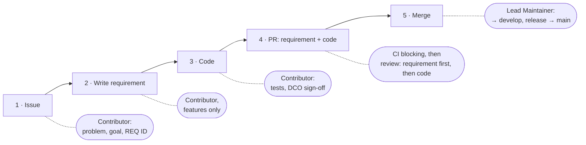
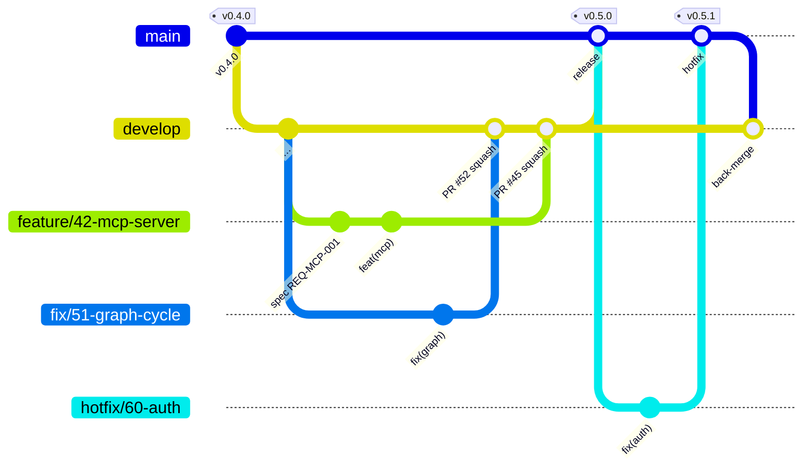

# Contribution Process Implementation Plan

> **For agentic workers:** REQUIRED SUB-SKILL: Use superpowers:subagent-driven-development (recommended) or superpowers:executing-plans to implement this plan task-by-task. Steps use checkbox (`- [ ]`) syntax for tracking.

**Goal:** Bring the owner's contribution guide (issue #39) into the repository: `develop`/`main` branching, merges only by Lead Maintainers, PR and issue templates, and every document that describes the process.

**Architecture:** Documentation and repository configuration only — no application code. Each task changes one coherent piece (one document or one GitHub configuration area) and is verified by grep checks, YAML parsing and the docs build.

**Tech Stack:** Markdown (GitHub-flavoured, Mermaid), GitHub issue forms (YAML), GitHub Actions, Zensical docs build, Claude Code project settings.

**Spec:** `docs/superpowers/specs/2026-10-18-contribution-process-design.md` (decisions D1–D11).

## Global Constraints

- Branch: `feature/39-contribution-process`, off `develop`. The PR targets `develop`.
- Everything in English (CLAUDE.md, ADR-020). Binding terms from `docs/glossary.md`: *Norm* = "norm", *Regelwerk* = "standards"; `Trägerorganisation` stays German.
- Role names exactly: **Contributor**, **Maintainer**, **Lead Maintainer**. The term "Technical lead" must not remain anywhere.
- Lead Maintainers: `Jan Wokittel (@Sn4kez)` and `Tobias Haarhoff (@TobiasHaarhoff)`.
- The Trägerorganisation is `normly e.V.`; a tie between the Lead Maintainers is decided by its board.
- Requirements live in `docs/srs/03-requirements.md` (index in `docs/srs/README.md`), ADRs in `docs/adr/README.md`. Never write `specs/REQ-*.md` or `adr/` as paths. Requirements have no status field.
- Branch prefixes exactly: `feature/<issue>-…`, `fix/<issue>-…`, `hotfix/<issue>-…`.
- Merge methods: work branches → `develop` squash; `develop` → `main`, `hotfix/…` → `main`, `main` → `develop` merge commit.
- `edge` images are built from `main` only. `.github/workflows/images.yml` is **not** changed.
- No automatic DCO check exists; never claim one.
- No license check exists in CI; never claim one.
- AI involvement: `Assisted-by: <tool>` — never `Co-Authored-By`, never a `Signed-off-by` for a tool.
- Every commit in this plan: `git commit -s` with the trailer `Assisted-by: Claude Code` and `Refs: #39` in the body. Before the first commit check `git var GIT_AUTHOR_IDENT` prints `Jan Wokittel <33695461+Sn4kez@users.noreply.github.com>`; stop if not. Never run `git config`.
- New YAML files under `.github/` start with the SPDX header used by `images.yml`:
  ```
  # SPDX-License-Identifier: AGPL-3.0-or-later
  # Copyright (C) 2026 normly contributors
  ```
- No push, no PR in any task — Task 8 ends local; pushing is the owner's call.

---

### Task 1: Rewrite CONTRIBUTING.md

**Files:**
- Modify (full replacement): `CONTRIBUTING.md`

**Interfaces:**
- Produces: the section anchors `#working-with-ai`, `#branches`, `#developer-certificate-of-origin-dco` — README (Task 2) and the PR template (Task 3) link to `CONTRIBUTING.md` and `CONTRIBUTING.md#working-with-ai`.

- [ ] **Step 1: Replace the file with exactly this content**

````markdown
# Contributing to normly

How contributions to normly come together – from issue to release. The
process is deliberately lightweight and grows with the project.

Contributions are explicitly **not just code**. Correcting a cross-reference
between standards, reporting a wrong supersession chain, or suggesting a
source contributes to the most valuable part of the project — practical
domain knowledge is often more useful here than a patch.

## Principles

1. **Requirement before code.** Every functional change traces back to a
   requirement in [docs/srs/03-requirements.md](docs/srs/03-requirements.md).
2. **Traceable.** Every contribution carries the chain *issue → REQ ID → PR*.
3. **CI decides first.** The pipeline (tests, docs build, shellcheck) is
   blocking. Humans review requirement conformance and design.
4. **AI is welcome.** Under the rules in [Working with AI](#working-with-ai).

## Roles

| Role | Decides on |
|---|---|
| **Contributor** – anyone with a PR | Requirement draft and implementation |
| **Maintainer** – listed in [MAINTAINERS.md](MAINTAINERS.md) | Requirement approval, review |
| **Lead Maintainer** – listed in [MAINTAINERS.md](MAINTAINERS.md) | Architecture (ADRs), every merge into `develop` and `main`, releases, conflicts |

Roles are hats, not people: whoever wants to build a feature writes its
requirement. Process and licensing questions are decided by normly e.V.
If the Lead Maintainers disagree, the board of normly e.V. decides. Details
in [GOVERNANCE.md](GOVERNANCE.md).

## Workflow



Two kinds of contribution determine whether step 2 is needed:

| | **Fix** | **Feature** |
|---|---|---|
| What | Bug, docs, refactoring within an existing requirement | New or changed functionality, including new documentation |
| Requirement | Reference to an existing REQ ID is enough | New or changed REQ with acceptance criteria in the same PR; a separate requirement PR is optional for early feedback |
| Review | Maintainer | Maintainer; if data model or interfaces are affected, additionally an ADR and a Lead Maintainer |
| Merge | Lead Maintainer | Lead Maintainer |

**Requirement** = an entry in [docs/srs/03-requirements.md](docs/srs/03-requirements.md)
with a stable ID (`REQ-<DOMAIN>-<NNN>`) and acceptance criteria; the
requirement index is in [docs/srs/README.md](docs/srs/README.md).
**ADR** = Architecture Decision Record in [docs/adr/README.md](docs/adr/README.md),
recording *why* something is built the way it is.

## Branches

| Branch | Purpose |
|---|---|
| `main` | Production, tagged releases, protected |
| `develop` | Integration and default branch, protected, merge only via PR with green CI |
| `feature/<issue>-…`, `fix/<issue>-…` | Work branches off `develop`, squash-merged into `develop` |
| `hotfix/<issue>-…` | Critical fixes off `main`, merged into `main`, then `main` is merged back into `develop` |



Only Lead Maintainers merge. Work branches are **squash-merged** into
`develop` — one commit per PR. The release (`develop` → `main`), hotfixes
into `main` and the back-merge (`main` → `develop`) are **merge commits**:
squashing them would give `main` commits that `develop` does not know, and
every later back-merge would conflict. Releases are tagged on `main`; see
[docs/guide/releasing.md](docs/guide/releasing.md). The `edge` container
image is built from `main` only, so it always reflects production
(ADR-028).

## Commits

Commits follow [Conventional Commits](https://www.conventionalcommits.org/),
name the REQ ID and carry the DCO sign-off:

```
feat(graph): resolve supersession chains recursively

Implements REQ-GRAPH-006. Refs: #42

Signed-off-by: First Last <mail@example.org>
Assisted-by: Claude Code
```

`Assisted-by:` appears only if AI was used — see
[Working with AI](#working-with-ai).

## Developer Certificate of Origin (DCO)

normly uses the **DCO** instead of a Contributor License Agreement. You
don't transfer any rights; you only confirm that you're allowed to
contribute the change. The full text is at <https://developercertificate.org/>.

Every commit needs a `Signed-off-by` line for this:

```bash
git commit -s -m "fix: correct supersession chain for DIN EN ISO 9001"
```

The `-s` flag automatically appends:

```
Signed-off-by: First Last <mail@example.org>
```

Name and email must match your git configuration. Pseudonyms are not
allowed — the DCO requires an identifiable person. If you don't want your
private address in public commits, use the noreply address GitHub shows
under *Settings → Emails*.

Forgot to sign off? Sign afterwards:

```bash
git commit --amend -s          # last commit
git rebase --signoff develop   # multiple commits
```

There is no automatic check: every contributor signs off their own
commits. The merging Lead Maintainer checks the sign-offs and keeps the
`Signed-off-by` lines in the squash commit message. Without a sign-off,
nothing gets merged.

**Deliberate consequence:** because the rights stay with the contributors, a
later relicensing of the core is permanently ruled out. That's intentional —
see [ADR-003](docs/adr/README.md).

## Pull requests

Open the PR against `develop` (hotfix: against `main`). The
[PR template](.github/pull_request_template.md) asks for the issue, the
REQ ID, the type and a short checklist: tests, documentation, ADR draft,
breaking changes, new data sources, dependency licenses, license headers,
credentials, DCO, AI use.

Issues start from the forms under *New issue*: bug, feature, data error,
new data source. Security vulnerabilities are **not** reported as an issue —
see [SECURITY.md](SECURITY.md).

## Working with AI

AI-assisted development is explicitly welcome. Five rules:

1. **A human is accountable.** Whoever opens the PR understands every line
   and can explain it. The sign-off is always that of a natural person.
2. **Transparency.** AI use is stated in the PR and as `Assisted-by:` in
   the commit — never as `Co-Authored-By` and never as `Signed-off-by`.
3. **The requirement is the source.** Code that deviates from the
   requirement is wrong – regardless of who wrote it.
4. **No third-party content in prompts.** Licensed standards texts,
   partner data, secrets, personal data.
5. **AI reviews, it does not decide.** An approval comes from a human.

## Scaling

| | **Now** (core team) | **Once external contributions arrive** |
|---|---|---|
| Internal review | Lead Maintainer merges after green CI; architecture always Lead Maintainer | unchanged |
| External review | – | 1 Maintainer reviews, a Lead Maintainer merges |
| Branch protection | `develop` and `main`: PR with green CI required, merge only by Lead Maintainers | + required review for external PRs, CODEOWNERS per module |

Merging without a second review within the core team is a deliberate risk
carried by CI – which is why a working test suite is a prerequisite for
this process.

## Development setup

The four Python packages (`core`, `api`, `chat`, `accounts`) form one
[uv](https://docs.astral.sh/uv/) workspace with a single lock file
(`uv.lock`). One environment in the repository root serves all of them:

```bash
curl -LsSf https://astral.sh/uv/0.12.23/install.sh | sh
uv sync --all-packages --all-extras      # creates .venv with every package and dev extra
cd api && ../.venv/bin/pytest            # run one package's tests (needs Docker for testcontainers)
```

`uv sync` keeps `.venv` in step with `uv.lock`. Change a dependency in a
package's `pyproject.toml`, then run `uv lock` and commit the updated
`uv.lock` with it — CI installs with `--locked` and fails when the lock
file is out of date. The frontend uses `npm ci` with `package-lock.json`
as before.

## License header

New files in the core:

```
// SPDX-License-Identifier: AGPL-3.0-or-later
// Copyright (C) 2026 normly contributors
```

In SDKs and the API specification, use `Apache-2.0` instead.

## Non-negotiable boundaries

These points have legal or strategic reasons. We can't accept PRs that
violate them — even if the code is good. Better to ask in an issue first.

- **No US services** for operations, user data, the standards knowledge
  base, credentials, or production deployment. Exception since ADR-021:
  source code, CI/CD, and the container registry of the free core live on
  GitHub.
- **No scraping of commercially exploited catalog holdings.** Not even if
  they're publicly accessible. New sources need an entry in the source
  registry with an assigned legal basis.
- **No DRM or protection logic in the free core.** Exposed protection code
  is no protection; such components live outside this repository.
- **No account requirement for free content.**
- **No personalized advertising**, no user profiles for advertising
  purposes.
- **No proprietary component in the core.** It must remain buildable,
  testable, and runnable without add-on modules.
- **No direct database access** outside the repository layer.

Detailed rationale: [docs/adr/](docs/adr/).

## Contributions without code

- **Errors in the data** — a wrong reference, an outdated validity status,
  a missing supersession: use the *Data error* form, with a source.
  Especially welcome.
- **New sources** — use the *New data source* form: which standard, which
  publisher, which legal basis for use.
- **Translations and terminology** — normly is meant to work worldwide in
  the long run.
- **Documentation** — if something was unclear, it was unclear.

## Conduct

The [Code of Conduct](CODE_OF_CONDUCT.md) applies.

## Questions

For anything unclear: open an issue. Better one question too many than a
day of wasted work.

---

Changes to this document go through a PR labelled `process`.
````

- [ ] **Step 2: Verify the constraints by grep**

Run:
```bash
grep -n -E "Technical lead|specs/REQ|\]\(adr/|Self-merge|self-merge|runs automatically|license checks|Co-Authored-By" CONTRIBUTING.md
```
Expected: exactly one hit — the line in *Working with AI* that says "never as `Co-Authored-By`". Anything else is a defect.

Run:
```bash
grep -c -E "Lead Maintainer" CONTRIBUTING.md; grep -n "```mermaid" CONTRIBUTING.md
```
Expected: count ≥ 8; two mermaid blocks (flowchart, gitGraph).

- [ ] **Step 3: Commit**

```bash
git add CONTRIBUTING.md
git commit -s -F - <<'EOF'
docs: rework the contribution process along the new guide

Adds roles, the issue -> requirement -> PR workflow, develop/main
branching with squash and merge-commit rules, merges by Lead Maintainers
only, the Working with AI rules and the scaling table. Removes the claim
of an automatic DCO check, which does not exist.

Refs: #39

Assisted-by: Claude Code
EOF
```

---

### Task 2: README contributing section

**Files:**
- Modify: `README.md:61-71` (the `## Contributing` section, up to but not including `## Where the code lives`)

**Interfaces:**
- Consumes: `CONTRIBUTING.md#branches` from Task 1.

- [ ] **Step 1: Replace the section**

Replace everything from the line `## Contributing` up to the blank line before `## Where the code lives` with:

````markdown
## Contributing

Every contribution follows the same path: **issue → requirement → branch →
pull request → merge by a Lead Maintainer.** Branch off `develop` as
`feature/<issue>-…` or `fix/<issue>-…`, open the PR against `develop`;
critical fixes go as `hotfix/<issue>-…` against `main`. Releases are merged
from `develop` into `main` and tagged.


Contributions go through the **Developer Certificate of Origin** (DCO), not
a transfer of rights. Every commit needs a `Signed-off-by` line:

```bash
git commit -s -m "feat: short description"
```

Details — roles, requirements, merge rules, working with AI — in
[CONTRIBUTING.md](CONTRIBUTING.md). Please **do not** report security
vulnerabilities as an issue — see [SECURITY.md](SECURITY.md).
````

- [ ] **Step 2: Verify**

Run:
```bash
sed -n '/^## Contributing/,/^## Where the code lives/p' README.md | grep -c -E "gitGraph|develop|SECURITY.md|CONTRIBUTING.md"
```
Expected: ≥ 4. And `grep -n "^## " README.md` still lists `## Where the code lives` directly after `## Contributing`.

- [ ] **Step 3: Commit**

```bash
git add README.md
git commit -s -F - <<'EOF'
docs(readme): show the branch model in the contributing section

Refs: #39

Assisted-by: Claude Code
EOF
```

---

### Task 3: PR template, issue forms, CODEOWNERS

**Files:**
- Create: `.github/pull_request_template.md`
- Create: `.github/ISSUE_TEMPLATE/config.yml`
- Create: `.github/ISSUE_TEMPLATE/bug.yml`
- Create: `.github/ISSUE_TEMPLATE/feature.yml`
- Create: `.github/ISSUE_TEMPLATE/data-error.yml`
- Create: `.github/ISSUE_TEMPLATE/new-source.yml`
- Create: `.github/CODEOWNERS`

**Interfaces:**
- Consumes: `CONTRIBUTING.md#working-with-ai` (Task 1). Labels used must already exist: `bug`, `enhancement`, `documentation` (they do).

- [ ] **Step 1: Create `.github/pull_request_template.md`**

```markdown
Issue: #    Spec: REQ-XXX-NNN    Type: Fix | Feature | Hotfix
Target: develop (hotfix: main)

**What and why**

**Acceptance criteria**
- [ ] … met by …

- [ ] Tests added
- [ ] Documentation updated (README, guides, code reference)
- [ ] ADR draft included, if architecture, data model or interfaces change
- [ ] Breaking change or migration: no | yes (described above)
- [ ] New data source: register entry with category A–D and legal basis
- [ ] New dependencies license-checked
- [ ] New source files carry the license header
- [ ] No credentials in code, not even in tests or examples
- [ ] DCO sign-off on every commit
- [ ] AI used: no | yes (tool, recorded as `Assisted-by:` — see [CONTRIBUTING.md](../CONTRIBUTING.md#working-with-ai))
```

- [ ] **Step 2: Create `.github/ISSUE_TEMPLATE/config.yml`**

```yaml
# SPDX-License-Identifier: AGPL-3.0-or-later
# Copyright (C) 2026 normly contributors
blank_issues_enabled: false
contact_links:
  - name: Security vulnerability
    url: https://github.com/normly/web-app/blob/main/SECURITY.md
    about: Please do not report vulnerabilities as an issue — follow SECURITY.md.
```

- [ ] **Step 3: Create `.github/ISSUE_TEMPLATE/bug.yml`**

```yaml
# SPDX-License-Identifier: AGPL-3.0-or-later
# Copyright (C) 2026 normly contributors
name: Bug
description: Something in normly does not work as described.
labels: ["bug"]
body:
  - type: textarea
    id: what
    attributes:
      label: What happened
    validations:
      required: true
  - type: textarea
    id: expected
    attributes:
      label: What you expected
    validations:
      required: true
  - type: textarea
    id: steps
    attributes:
      label: Steps to reproduce
      placeholder: "1. …\n2. …"
    validations:
      required: true
  - type: input
    id: version
    attributes:
      label: Version or instance
      description: Release tag, image tag (e.g. edge, 0.2.0) or the URL of the instance.
  - type: input
    id: requirement
    attributes:
      label: Affected requirement
      description: REQ ID from docs/srs/03-requirements.md, if known.
      placeholder: REQ-UI-001
```

- [ ] **Step 4: Create `.github/ISSUE_TEMPLATE/feature.yml`**

```yaml
# SPDX-License-Identifier: AGPL-3.0-or-later
# Copyright (C) 2026 normly contributors
name: Feature
description: New or changed functionality, including documentation.
labels: ["enhancement"]
body:
  - type: textarea
    id: problem
    attributes:
      label: Problem
      description: What can't be done today, and for whom?
    validations:
      required: true
  - type: textarea
    id: goal
    attributes:
      label: Goal
      description: What should be possible afterwards?
    validations:
      required: true
  - type: input
    id: requirement
    attributes:
      label: Requirement
      description: Existing REQ ID from docs/srs/03-requirements.md, or "new" if a requirement still has to be written.
      placeholder: REQ-UI-001 or new
    validations:
      required: true
  - type: checkboxes
    id: boundaries
    attributes:
      label: Non-negotiable boundaries
      options:
        - label: I have read the non-negotiable boundaries in CONTRIBUTING.md; this proposal does not cross them.
          required: true
```

- [ ] **Step 5: Create `.github/ISSUE_TEMPLATE/data-error.yml`**

```yaml
# SPDX-License-Identifier: AGPL-3.0-or-later
# Copyright (C) 2026 normly contributors
name: Data error
description: A wrong reference, an outdated validity status, a missing supersession.
labels: ["bug"]
body:
  - type: input
    id: document
    attributes:
      label: Affected norm or standard
      placeholder: DIN EN ISO 9001:2015
    validations:
      required: true
  - type: textarea
    id: wrong
    attributes:
      label: What is wrong
    validations:
      required: true
  - type: textarea
    id: correct
    attributes:
      label: What is correct
    validations:
      required: true
  - type: textarea
    id: source
    attributes:
      label: Source
      description: Where the correct information can be checked — official gazette, publisher page, legal text. Do not paste copyrighted full texts.
    validations:
      required: true
```

- [ ] **Step 6: Create `.github/ISSUE_TEMPLATE/new-source.yml`**

```yaml
# SPDX-License-Identifier: AGPL-3.0-or-later
# Copyright (C) 2026 normly contributors
name: New data source
description: Suggest a source of norms and standards for normly.
labels: ["enhancement"]
body:
  - type: input
    id: publisher
    attributes:
      label: Publisher
    validations:
      required: true
  - type: input
    id: url
    attributes:
      label: Where it is published
      placeholder: https://…
    validations:
      required: true
  - type: textarea
    id: content
    attributes:
      label: What it contains
      description: Which standards, how many, which formats.
    validations:
      required: true
  - type: dropdown
    id: category
    attributes:
      label: Category
      options:
        - A — official works, legal texts (§ 5 UrhG or similar)
        - B — freely licensed standards (license of the publisher)
        - C — obtained by contract (contract reference)
        - D — other publicly accessible (case-by-case review, § 44b Abs. 3 UrhG)
    validations:
      required: true
  - type: textarea
    id: legal-basis
    attributes:
      label: Legal basis
      description: License, legal provision or contract that allows the use; for category D also the publisher's rights reservation for text and data mining, if any.
    validations:
      required: true
  - type: checkboxes
    id: catalog
    attributes:
      label: Commercial catalogs
      options:
        - label: This source is not a commercially exploited catalog collection (e.g. DIN Media/Nautos). Such collections are only obtained by contract, never scraped.
          required: true
```

- [ ] **Step 7: Create `.github/CODEOWNERS`**

```
# SPDX-License-Identifier: AGPL-3.0-or-later
# Copyright (C) 2026 normly contributors
#
# Lead Maintainers are asked for review on every PR. Per-module owners
# follow once external contributions arrive (CONTRIBUTING.md, Scaling).
* @Sn4kez @TobiasHaarhoff
```

- [ ] **Step 8: Verify the YAML parses and the forms have the required keys**

Run:
```bash
python3 -I - <<'EOF'
import pathlib, yaml
for p in sorted(pathlib.Path(".github/ISSUE_TEMPLATE").glob("*.yml")):
    d = yaml.safe_load(p.read_text())
    if p.name == "config.yml":
        assert d["blank_issues_enabled"] is False, p
    else:
        assert {"name", "description", "body"} <= d.keys(), p
        ids = [b["id"] for b in d["body"]]
        assert len(ids) == len(set(ids)), p
    print("ok", p)
EOF
```
Expected: five `ok` lines. If `yaml` is missing, run the same with `.venv/bin/python -I` (PyYAML is a dependency there) .

- [ ] **Step 9: Commit**

```bash
git add .github/pull_request_template.md .github/ISSUE_TEMPLATE .github/CODEOWNERS
git commit -s -F - <<'EOF'
chore(github): add PR template, issue forms and CODEOWNERS

The issue forms cover bugs, features, data errors and new data sources;
the source form asks for category A-D and rules out commercially
exploited catalogs. Blank issues are off, vulnerabilities point to
SECURITY.md.

Refs: #39

Assisted-by: Claude Code
EOF
```

---

### Task 4: GOVERNANCE.md and MAINTAINERS.md

**Files:**
- Modify: `GOVERNANCE.md` (sections *Structure*, *Roles*, *Decisions*)
- Modify: `MAINTAINERS.md` (full replacement)

- [ ] **Step 1: GOVERNANCE.md — Trägerorganisation**

Replace:
```markdown
**Trägerorganisation** — holds the trademark, open data and source code, is
```
with:
```markdown
**Trägerorganisation** (normly e.V.) — holds the trademark, open data and source code, is
```

- [ ] **Step 2: GOVERNANCE.md — roles**

Replace:
```markdown
**Maintainers** — may merge and are responsible for an area. Admitted by
existing maintainers after a sustained contribution over a longer period. The
current list is in `MAINTAINERS.md`.

**Technical lead** — decides when the maintainers cannot reach agreement, and
is responsible for compliance with the architecture principles.
```
with:
```markdown
**Maintainers** — review contributions and approve requirements in their
area; they do not merge. Admitted by the Lead Maintainers after a sustained
contribution over a longer period. The current list is in `MAINTAINERS.md`.

**Lead Maintainers** — the only ones who merge, into `develop` and into
`main`; decide on architecture (ADRs) and releases, decide when the
maintainers cannot reach agreement, and are responsible for compliance with
the architecture principles. If the Lead Maintainers disagree, the board of
normly e.V. decides.
```

- [ ] **Step 3: GOVERNANCE.md — decisions**

Replace:
```markdown
consensus is discussed among the maintainers; if it remains disputed, the
technical lead decides.
```
with:
```markdown
consensus is discussed among the maintainers; if it remains disputed, the
Lead Maintainers decide, and if they disagree, the board of normly e.V.
```

- [ ] **Step 4: MAINTAINERS.md — replace the file**

```markdown
# Maintainers

Responsibilities by area. Only Lead Maintainers merge; Maintainers review
and approve requirements in their area. Details in
[CONTRIBUTING.md](CONTRIBUTING.md) and [GOVERNANCE.md](GOVERNANCE.md).

## Lead Maintainers

- Jan Wokittel ([@Sn4kez](https://github.com/Sn4kez))
- Tobias Haarhoff ([@TobiasHaarhoff](https://github.com/TobiasHaarhoff))

## Areas

| Area | Responsible |
|---|---|
| Core and API | *(to be added)* |
| Reference graph and data model | *(to be added)* |
| Processing chain and sources | *(to be added)* |
| Infrastructure and shipping | *(to be added)* |

Admission as a Maintainer is by the Lead Maintainers after a sustained
contribution over a longer period.
```

- [ ] **Step 5: Verify**

Run:
```bash
grep -rn -i "technical lead" --include=*.md . | grep -v "docs/superpowers/"
```
Expected: no output.

- [ ] **Step 6: Commit**

```bash
git add GOVERNANCE.md MAINTAINERS.md
git commit -s -F - <<'EOF'
docs(governance): name the Lead Maintainers and the merge rule

Replaces the technical lead with two Lead Maintainers who alone merge,
names normly e.V. as the Trägerorganisation and its board as tie-break.

Refs: #39

Assisted-by: Claude Code
EOF
```

---

### Task 5: ADR-028, open items, releasing guide

**Files:**
- Modify: `docs/adr/README.md` (insert ADR-028 after ADR-027, before `## Open items`; update one row of *Open items*)
- Modify: `docs/guide/releasing.md` (section *Cutting a release*, plus one sentence under *What gets published*)

- [ ] **Step 1: Insert ADR-028**

Directly before the `---` line that precedes `## Open items`, insert (keep one `---` separator between entries, as the file does):

```markdown
---

## ADR-028 — Branching and merge model: `develop` integration, Lead Maintainer merges

**Status:** accepted (2026-10-19); builds on ADR-003 and ADR-021

**Context:** Until October 2026 one person worked on `main` directly
through pull requests. With a second Lead Maintainer and outside
contributions ahead, `main` alone mixes integration and production: every
merge rebuilt the `edge` image that the VM tracks.

**Decision:**

- `main` is production and carries the release tags. `develop` is the
  integration and default branch. Work branches are named
  `feature/<issue>-…`, `fix/<issue>-…` (off `develop`) and
  `hotfix/<issue>-…` (off `main`).
- Only Lead Maintainers merge, into `develop` and into `main`. A Lead
  Maintainer may merge their own PR after green CI; no second review is
  required. Maintainers review and approve requirements.
- Work branches are squash-merged into `develop`. The release
  (`develop` → `main`), hotfixes into `main` and the back-merge
  (`main` → `develop`) are merge commits — a squashed release would give
  `main` commits `develop` does not know.
- The DCO sign-off is set by each contributor (`git commit -s`); there is
  no automatic check. The merging Lead Maintainer keeps the
  `Signed-off-by` lines in the squash commit message.
- AI involvement is recorded as `Assisted-by: <tool>`, never as
  `Co-Authored-By` or `Signed-off-by`.
- The `edge` image keeps being built from `main` only; with `develop` in
  place it tracks production, not integration.

**Rationale:** Outside contributions need an integration branch that is
not production, and a single, known group that decides what reaches it.
Squash keeps `develop` readable (one commit per PR); merge commits keep
`develop` and `main` related.

**Knowingly accepted:** Every release needs a merge and a back-merge.
Merging without a second review is a risk carried by CI.

**Rejected:** GitHub Flow with `main` only — no integration stage before
production. Merges by every Maintainer — unreviewed changes could reach
`develop`. An automatic DCO check — postponed, not ruled out.
```

- [ ] **Step 2: Update the open-items row**

Replace:
```markdown
| Legal form of the Trägerorganisation (e.V. / eG / alternative) | open | An eG could bring standardization bodies in as members instead of opponents |
```
with:
```markdown
| Legal form of the Trägerorganisation | decided (2026-10-19): normly e.V. | Remove this entry once the association is registered |
```

- [ ] **Step 3: releasing.md — what gets published**

After the paragraph ending "`latest` always means the newest release, never `edge`. Only `vX.Y.Z` tags publish (no pre-release tags yet), and manual runs are accepted only from `main` or a release tag." add a new paragraph:

```markdown
`main` changes only through releases and hotfixes (ADR-028), so `edge`
tracks production. Day-to-day work is merged into `develop`, which builds
no images.
```

- [ ] **Step 4: releasing.md — cutting a release**

Replace steps 1–3 of *Cutting a release* (from "1. Set the same version" up to and including the code block with `git push origin v0.2.0`) with:

````markdown
1. Set the same version in all five places and commit it on a branch off
   `develop`: `core/pyproject.toml`, `api/pyproject.toml`,
   `chat/pyproject.toml`, `accounts/pyproject.toml` (`[project] version`)
   and `frontend/package.json` (then
   `cd frontend && npm install --package-lock-only` so `package-lock.json`
   follows). Run `uv lock` afterwards: `uv.lock` records the workspace
   packages' versions, and CI installs with `--locked`, so a stale lock
   fails the PR. The workflow refuses a tag whose version differs from any
   of the five fields. A Lead Maintainer squash-merges that branch into
   `develop`.
2. Open a pull request from `develop` into `main`. A Lead Maintainer
   merges it with a **merge commit**, never squash (ADR-028).
3. Tag the merge commit and push the tag:

   ```bash
   git switch main && git pull
   git tag -a v0.2.0 -m "normly 0.2.0"
   git push origin v0.2.0
   ```
````

- [ ] **Step 5: releasing.md — hotfix and failed runs**

In step 4, replace "fix on `main`, delete the tag locally and remotely, and tag again." with "fix through a `hotfix/<issue>-…` branch into `main`, delete the tag locally and remotely, and tag again."

Then, after step 5 (the `normly-deploy` step) and before `## First publish only`, add:

```markdown
## Hotfixes

A critical fix branches off `main` as `hotfix/<issue>-…` and goes back to
`main` through a pull request, merged by a Lead Maintainer with a merge
commit. Tag it like a release (patch version). Afterwards open a pull
request from `main` into `develop` and merge it with a merge commit, so the
fix is not lost with the next release.
```

- [ ] **Step 6: Build the docs**

Run (the same pins as the `test-docs` CI job, in a throwaway venv in the scratchpad):
```bash
python3 -m venv "$SCRATCH/docs-venv" && "$SCRATCH/docs-venv/bin/pip" install -q "zensical==0.0.60" "mkdocstrings==1.0.6" "mkdocstrings-python==2.0.8" "griffelib==2.3.0" "pymdown-extensions==12.1" && "$SCRATCH/docs-venv/bin/zensical" build 2>&1 | tail -20
```
(`$SCRATCH` = the session scratchpad directory.) Expected: build succeeds; compare warnings against `.github/workflows/ci.yml` lines 76–90 — whatever the CI job treats as failure must not appear. `site/` is not git-ignored: delete it after the build (`rm -rf site`) and make sure it is never staged.

- [ ] **Step 7: Commit**

```bash
git add docs/adr/README.md docs/guide/releasing.md
git commit -s -F - <<'EOF'
docs(adr): record the branching and merge model as ADR-028

Releases now go develop -> main with a merge commit; hotfixes branch off
main and are merged back into develop. edge stays built from main only.
The legal form of the Trägerorganisation is decided: normly e.V.

Refs: #39

Assisted-by: Claude Code
EOF
```

---

### Task 6: CI runs for `develop`

**Files:**
- Modify: `.github/workflows/ci.yml:2-6`

- [ ] **Step 1: Change the triggers**

Replace:
```yaml
on:
  pull_request:
    branches: [main]
  push:
    branches: [main]
```
with:
```yaml
on:
  pull_request:
    branches: [main, develop]
  push:
    branches: [main, develop]
```

- [ ] **Step 2: Verify `images.yml` is untouched and the YAML parses**

Run:
```bash
git diff --stat origin/develop -- .github/workflows/images.yml
python3 -I -c "import yaml,sys; d=yaml.safe_load(open('.github/workflows/ci.yml')); t=d[True]; print(t['pull_request']['branches'], t['push']['branches'])"
```
Expected: no diff output for `images.yml`; `['main', 'develop'] ['main', 'develop']` (PyYAML parses the key `on` as `True`).

- [ ] **Step 3: Commit**

```bash
git add .github/workflows/ci.yml
git commit -s -F - <<'EOF'
ci: run the pipeline for pull requests and pushes on develop

Images stay built from main only (ADR-028).

Refs: #39

Assisted-by: Claude Code
EOF
```

---

### Task 7: CLAUDE.md and Claude Code attribution

**Files:**
- Modify: `CLAUDE.md:43-48` (section *For every code change*)
- Create: `.claude/settings.json`

- [ ] **Step 1: CLAUDE.md**

Replace:
```markdown
- **Commits** need `Signed-off-by` (DCO). Conventional Commits, SemVer.
- **No direct push to `main`** — merge request with review and a green
  pipeline.
```
with:
```markdown
- **Commits** need `Signed-off-by` (DCO) of a natural person. Conventional
  Commits, SemVer. AI involvement is recorded as `Assisted-by: <tool>` —
  never as `Co-Authored-By`, never as `Signed-off-by`.
- **Branches** off `develop` as `feature/<issue>-…` or `fix/<issue>-…`;
  hotfixes off `main` as `hotfix/<issue>-…`. → ADR-028
- **No direct push to `main` or `develop`** — pull request with a green
  pipeline, merged only by a Lead Maintainer. → ADR-028
```

- [ ] **Step 2: Create `.claude/settings.json`**

Key verified on 2026-10-19 against https://code.claude.com/docs/en/settings-reference.md: `attribution.commit` replaces the `Co-Authored-By` trailer, `attribution.pr: ""` hides the PR footer; `includeCoAuthoredBy` is deprecated and must not be used.

```json
{
  "attribution": {
    "commit": "Assisted-by: Claude Code",
    "pr": ""
  }
}
```

The settings take effect in the next Claude Code session; whether Claude Code inserts a blank line before the trailer is checked on the first commit after this branch is merged, not here.

- [ ] **Step 3: Verify**

Run:
```bash
python3 -I -c "import json; print(json.load(open('.claude/settings.json')))"
grep -n -E "ADR-028|Assisted-by|develop" CLAUDE.md
git check-ignore -v .claude/settings.json || echo "not ignored"
```
Expected: the JSON prints; three CLAUDE.md lines match; `not ignored` (the file must be committed so it applies to every Lead Maintainer).

- [ ] **Step 4: Commit**

```bash
git add CLAUDE.md .claude/settings.json
git commit -s -F - <<'EOF'
chore: record AI involvement as Assisted-by, branch off develop

CLAUDE.md now states the develop/main branching and the Lead Maintainer
merge rule; the project settings make Claude Code append Assisted-by
instead of a Co-Authored-By trailer.

Refs: #39

Assisted-by: Claude Code
EOF
```

---

### Task 8: Whole-branch verification

**Files:** none changed (fix-ups only if a check fails, committed as `docs: …` with the same trailers).

- [ ] **Step 1: Forbidden terms across the branch**

Run:
```bash
git diff --name-only origin/develop...HEAD
grep -rn -E "Technical lead|technical lead|specs/REQ|Self-merge on green|runs automatically" -- CONTRIBUTING.md README.md GOVERNANCE.md MAINTAINERS.md CLAUDE.md docs/adr/README.md docs/guide/releasing.md .github
```
Expected: the file list covers every file of Tasks 1–7 plus the spec and this plan; the grep prints nothing.

- [ ] **Step 2: Every commit signed off by the owner and marked as assisted**

Run:
```bash
git log origin/develop..HEAD --format='%h %an | %(trailers:key=Signed-off-by,valueonly,separator=;) | %(trailers:key=Assisted-by,valueonly) | %(trailers:key=Co-Authored-By,valueonly)'
```
Expected: every line shows `Jan Wokittel`, the sign-off `Jan Wokittel <33695461+Sn4kez@users.noreply.github.com>`, `Claude Code`, and an empty last column.

- [ ] **Step 3: Docs build** — repeat Task 5 Step 6. Expected: succeeds.

- [ ] **Step 4: Mermaid syntax** — confirm the two `gitGraph` blocks (CONTRIBUTING.md, README.md) are byte-identical:
```bash
diff <(sed -n '/^```mermaid$/,/^```$/p' README.md) <(sed -n '/gitGraph/,/^```$/p' CONTRIBUTING.md | sed '1i ```mermaid')
```
Expected: no output. Rendering is checked on GitHub after the owner pushes.

- [ ] **Step 5: Report**

Report to the owner: the commit list, the results of Steps 1–4, and the owner's checklist that stays outside this branch (from the spec, *Out of scope*): permissions (review admin of @erolabzait), PR merge settings, the two rulesets (status checks on `develop` only after this PR is merged), label `process`. The push and the PR (target `develop`, label `process`, `Issue: #39`) wait for the owner's go.
